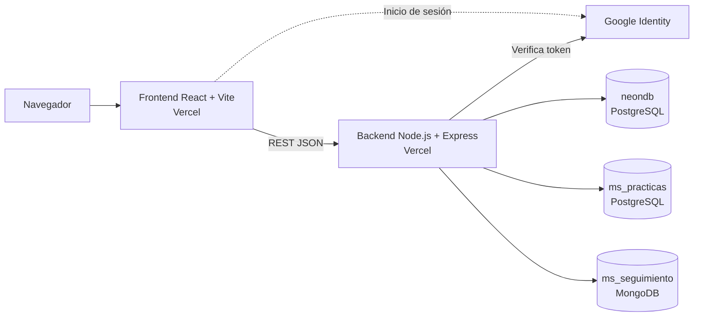

# SIGPA-II

**Software Integral de Gestión de Prácticas Académicas — versión web.**

Aplicación web para gestionar las prácticas académicas de un programa de licenciatura: convenios con instituciones, plazas, grupos de práctica, asignación de docentes asesores, bitácoras con evidencias, retroalimentación, supervisión de horas y reportes. Es la segunda parte del Proyecto Integrador (primer entregable en Java + SQL; esta versión es web con React, Node.js, PostgreSQL y MongoDB).

| | |
|---|---|
| **Aplicación (frontend)** | https://sigpa-ii-web.vercel.app |
| **API (backend)** | https://sigpa-ii-mu.vercel.app |
| **Repositorio** | https://github.com/ingFelipeGutierrez/SIGPA-II |
| **Programa / periodo** | Ingeniería de Sistemas · II-2026 · Quinto semestre |
| **Cursos vinculados** | Ingeniería del Software II · Programación III · Teoría General de Sistemas |

---

## 1. Cómo probar la aplicación (calificadores)

Abre https://sigpa-ii-web.vercel.app en Chrome o Edge. En la pantalla de inicio de sesión escribe **solo la palabra de usuario** (no el correo completo) y la contraseña `123456`:

| Usuario | Contraseña | Panel al que entra |
|---|---|---|
| `estudiante` | `123456` | Estudiante: mi práctica, bitácoras, evaluaciones |
| `docente` | `123456` | Docente asesor: mis estudiantes, bitácoras por revisar |
| `director` | `123456` | Director de programa: prácticas, instituciones, supervisión, reportes |
| `admin` | `123456` | Super Admin: solicitudes de registro y usuarios |

El panel del **Director** es el que tiene datos cargados; los del estudiante y el docente de prueba arrancan con poca información.

También se puede entrar con **Google** usando una cuenta `@udi.edu.co`. Si la cuenta no está registrada, la aplicación muestra el formulario "Solicitar acceso" y la solicitud queda pendiente hasta que un Super Admin la apruebe. La pantalla de consentimiento de Google está en modo *Testing*, por eso el acceso con Google solo funciona para cuentas autorizadas; para evaluar, usa los usuarios de prueba.

---

## 2. Funcionalidades por rol

**Estudiante**
- Ver su práctica (institución, grupo, docente asesor, fechas, horas requeridas y avance).
- Registrar bitácoras asociadas a una actividad, con evidencias, y corregirlas cuando el docente lo pide.
- Consultar retroalimentación y notas.

**Docente asesor**
- Ver sus estudiantes asignados y su avance.
- Revisar bitácoras: aprobarlas, pedir corrección, calificarlas y escribir retroalimentación.

**Director de programa**
- *Gestionar prácticas:* asignar docente asesor (máximo 6 estudiantes por docente), asignar estudiantes a grupos de práctica, aprobar o rechazar plazas y decidir el resultado de la práctica.
- *Instituciones receptoras:* registrar instituciones con su convenio y renovarlo.
- *Estado de las prácticas* y *Supervisión de horas*.
- *Reportes:* horas por institución, bitácoras por docente asesor, desempeño por práctica y convenios, con exportación a **PDF** y **Excel**.

**Super Admin**
- Aprobar o rechazar (con motivo) las solicitudes de registro.
- Crear, editar y eliminar usuarios de los cuatro roles.

El estado de cada práctica (pendiente, en curso, finalizada, aprobada, rechazada, cambiada) se calcula con una sola regla compartida por todos los paneles (`FRONTEND/app/src/utils/formato.js`, función `estadoPractica`).

---

## 3. Arquitectura



El sistema usa **tres bases de datos** con responsabilidades separadas:

| Base | Motor | Qué guarda |
|---|---|---|
| `neondb` | PostgreSQL (Neon) | Usuarios, roles (estudiante, docente asesor, director, admin) y solicitudes de registro |
| `ms_practicas` | PostgreSQL (Neon) | Instituciones, convenios, plazas, grupos de práctica, asignaciones de plaza y de docente, calificaciones |
| `ms_seguimiento` | MongoDB | Actividades, bitácoras, evidencias y retroalimentación |

**Regla de diseño:** no se hacen `JOIN` entre bases. Cuando una pantalla necesita datos de dos bases (por ejemplo el nombre del estudiante, que está en `neondb`, junto a su práctica, que está en `ms_practicas`), el backend o el frontend consultan cada base por separado y cruzan los resultados en JavaScript.

**Autenticación:** el frontend obtiene un token de Google (`@react-oauth/google`) y lo envía a `POST /api/login`; el backend lo verifica con `google-auth-library`, exige el dominio `@udi.edu.co` y busca al usuario por correo. Para los calificadores existe además `POST /api/login/prueba`, habilitado solo si `ENABLE_TEST_LOGIN=true`.

---

## 4. Tecnologías

- **Frontend:** React 19, Vite, React Router 7, GSAP (microinteracciones), `@react-oauth/google`, jsPDF + jspdf-autotable (PDF) y SheetJS `xlsx` (Excel).
- **Backend:** Node.js, Express 5, `pg` (PostgreSQL), `mongodb` (driver oficial), `google-auth-library`, `cors`, `dotenv`.
- **Bases de datos:** PostgreSQL en Neon y MongoDB.
- **Despliegue:** Vercel (dos proyectos desde este mismo repositorio).
- **Control de versiones:** Git + GitHub (GitKraken).

---

## 5. Estructura del repositorio

```
SIGPA-II/
├── BACKEND/
│   ├── index.js              # Express: rutas, CORS, endpoints /api/ping/*
│   ├── db/                   # Conexiones: neondb.js, practicas.js, mongo.js
│   ├── routes/               # usuarios, practicas, actividades, bitacoras,
│   │                         # retroalimentacion, evidencias, solicitudes,
│   │                         # reportes, login
│   └── scripts/              # volcar-esquemas.js y respaldo-mongo.js (solo lectura)
├── FRONTEND/
│   └── app/                  # Aplicación React (Vite)
│       ├── src/pages/        # estudiante/, docente/, director/, admin/, LoginPage
│       ├── src/layouts/      # PanelLayout (menú lateral + barra superior)
│       ├── src/components/   # Modal, Badge, Cargando, ToastContext, ...
│       ├── src/hooks/        # Un hook por pantalla: cargan y preparan los datos
│       ├── src/services/     # Llamadas a la API (api.js + un archivo por router)
│       ├── src/utils/        # formato.js, reportes.js, exportarReporte.js, roles.js
│       ├── src/context/      # AuthContext (sesión)
│       └── vercel.json       # Reescritura para que las rutas de React Router funcionen
├── UML/                      # Casos de uso, diagrama de casos de uso y documento maestro
├── DOCUMENTOS/               # Propuesta del proyecto integrador
└── README.md
```

---

## 6. Ejecutar el proyecto en local

**Requisitos:** Node.js (versión LTS reciente; en Vercel el backend corre con Node 24), acceso a las tres bases de datos y un ID de cliente OAuth de Google.

```bash
# 1) Backend
cd BACKEND
cp .env.example .env        # en Windows: copy .env.example .env  → y completar los valores
npm install
npm run dev                 # http://localhost:4000

# 2) Frontend (en otra terminal)
cd FRONTEND/app
cp .env.example .env        # completar VITE_API_URL y VITE_GOOGLE_CLIENT_ID
npm install
npm run dev                 # http://localhost:5173
```

Para que el inicio de sesión con Google funcione en local, `http://localhost:5173` debe estar en los *Orígenes autorizados de JavaScript* del cliente OAuth.

### Variables de entorno

| Dónde | Variable | Para qué sirve |
|---|---|---|
| Backend | `NEONDB_URL` | Conexión a `neondb` (usuarios y solicitudes) |
| Backend | `PRACTICAS_URL` | Conexión a `ms_practicas` |
| Backend | `MONGO_URI` | Conexión a MongoDB (`ms_seguimiento`) |
| Backend | `GOOGLE_CLIENT_ID` | Verificar los tokens de Google |
| Backend | `ENABLE_TEST_LOGIN` | `true` habilita el login de usuarios de prueba |
| Backend | `PORT` | Puerto local (por defecto 4000) |
| Frontend | `VITE_API_URL` | URL del backend, sin barra al final |
| Frontend | `VITE_GOOGLE_CLIENT_ID` | Cliente OAuth para el botón de Google |

Los archivos `.env` no se versionan; en el repositorio solo están los `.env.example`. Las variables del frontend se incorporan en el momento del *build*, así que si cambian en Vercel hay que volver a desplegar.

### Scripts útiles

| Comando | Dónde | Qué hace |
|---|---|---|
| `npm run dev` | BACKEND | Backend con recarga automática (nodemon) |
| `npm run dev` | FRONTEND/app | Servidor de desarrollo de Vite |
| `npm run lint` | FRONTEND/app | ESLint |
| `npm run build` | FRONTEND/app | Compila el frontend en `dist/` |
| `node scripts/volcar-esquemas.js` | BACKEND | Vuelca esquemas y restricciones de las tres bases a `scripts/_salida/` (solo lectura) |
| `node scripts/respaldo-mongo.js` | BACKEND | Exporta todas las colecciones de MongoDB a un JSON (solo lectura) |

---

## 7. API REST

Todas las rutas cuelgan de `/api` y responden JSON. Los códigos 4xx llevan `{ "error": "mensaje" }`.

| Router | Base | Rutas principales |
|---|---|---|
| `/api/login` | neondb | `POST /` (token de Google) · `POST /prueba` (usuario y clave de prueba) |
| `/api/solicitudes` | neondb | `POST /` · `GET /` · `GET /:id` · `PUT /:id/aprobar` · `PUT /:id/rechazar` |
| `/api/usuarios` | neondb | `GET /` · `GET /estudiantes` · `GET /docentes` · CRUD por rol en `/estudiantes-completos`, `/docentes-completos`, `/directores-completos`, `/admins-completos` |
| `/api/practicas` | ms_practicas | CRUD de `instituciones`, `convenios`, `plazas`, `grupos`, `tipos`, `niveles`, `grupo-estudiante`, `asignacion-plaza`, `asignacion-docente`, `docente-cupo`, `calificacion-bitacora`, `calificacion-evaluacion`; consultas compuestas `instituciones-completas`, `practicas-completas`, `mi-practica/:idEstudiante`, `estudiantes-docente/:idDocente` |
| `/api/actividades` | MongoDB | `POST /` · `GET /grupo/:id_grupo` · `GET /:id` · `PUT /:id` · `DELETE /:id` |
| `/api/bitacoras` | MongoDB | `POST /` · `GET /` · `GET /estudiante/:id` · `GET /docente/:idAsignacion` · `PUT /:id/aprobar` · `PUT /:id/correccion` · `PUT /:id` · `DELETE /:id` |
| `/api/evidencias` | MongoDB | `POST /` · `GET /bitacora/:id` · `GET /:id` · `DELETE /:id` |
| `/api/retroalimentacion` | MongoDB | `POST /` · `GET /estudiante/:id` · `GET /bitacora/:id` · `PUT /:id` · `DELETE /:id` |
| `/api/reportes` | varias | `GET /convenios` · `GET /horas` · `GET /horas-institucion` · `GET /bitacoras-docente` · `GET /desempeno` |
| `/api/ping/*` | todas | `GET /neondb` · `GET /practicas` · `GET /mongo` (comprueban la conexión a cada base) |

---

## 8. Despliegue

Dos proyectos de Vercel conectados a este repositorio (rama `main`, despliegue automático en cada *push*):

| Proyecto | Directorio raíz | Variables |
|---|---|---|
| `sigpa-ii` (API) | `BACKEND` | `NEONDB_URL`, `PRACTICAS_URL`, `MONGO_URI`, `GOOGLE_CLIENT_ID`, `ENABLE_TEST_LOGIN` |
| `sigpa-ii-web` (frontend) | `FRONTEND/app` | `VITE_API_URL`, `VITE_GOOGLE_CLIENT_ID` |

El backend exporta la aplicación de Express (`module.exports = app`) cuando corre en Vercel y abre un puerto propio cuando corre en local. El `vercel.json` del frontend reescribe todas las rutas a `index.html` para que React Router funcione al recargar la página.

---

## 9. Decisiones de diseño y limitaciones conocidas

Se documentan para que quien evalúe sepa qué es intencional y qué queda pendiente.

**Decisiones de diseño**
- **Bitácoras ligadas a una actividad**, al estilo de un aula virtual: el docente crea actividades para un grupo y el estudiante registra su bitácora contra una actividad.
- **Evidencias como enlaces** (con tipo y tamaño validados en MongoDB), no como subida de archivos al servidor.
- **Sin `JOIN` entre bases**: los datos de `neondb`, `ms_practicas` y `ms_seguimiento` se cruzan en JavaScript (ver sección 3).
- **Reportes calculados en el cliente** a partir de las consultas de la API; la exportación a PDF y Excel también se genera en el navegador.
- **Super Admin elimina en vez de desactivar** usuarios: la tabla `usuario` no tiene columna de estado activo. Al editar, el rol no se puede cambiar. Las cuentas de prueba están protegidas contra edición y eliminación.

**Limitaciones conocidas**
- **El backend no valida sesión por petición.** El acceso por rol se controla en el frontend (`RutaPrivada`), pero los endpoints de la API no exigen token y CORS está abierto. Para un uso real faltaría emitir y verificar un token de sesión (por ejemplo JWT) en cada ruta. Queda como trabajo futuro.
- **`xlsx` (SheetJS, versión de npm)** reporta una advertencia de seguridad en `npm audit`. Se usa solo para *generar* archivos de salida, no para leer archivos de terceros.
- **Excel sin encabezado en negrita:** la versión comunitaria de SheetJS no permite estilos.
- **Reportes:** las prácticas en estado "pendiente" y "cambiada" se excluyen; el reporte de convenios cuenta todas las plazas del convenio.
- **Google en modo *Testing*:** solo las cuentas agregadas como usuarios de prueba en la consola de Google pueden iniciar sesión con Google.
- **Login de prueba activo:** `ENABLE_TEST_LOGIN=true` se mantiene en producción para los calificadores; en un despliegue real se debe desactivar.

---

## 10. Documentación de análisis

En `UML/CASOS DE USO Y DIAGRAMA DE CASOS DE USO/` están los casos de uso detallados por rol (`Casos_de_Uso_Director.md`, `Casos_de_Uso_Docente.md`, `Casos_de_Uso_Estudiante.md`), el `Documento_Maestro_Prototipo.md` con las reglas de negocio, el análisis `Hallazgos_Prototipo_vs_CU.md` y el diagrama de casos de uso (`.asta`).

---

## Autor

Felipe Gutiérrez — Ingeniería de Sistemas, Universidad de Investigación y Desarrollo (UDI).
